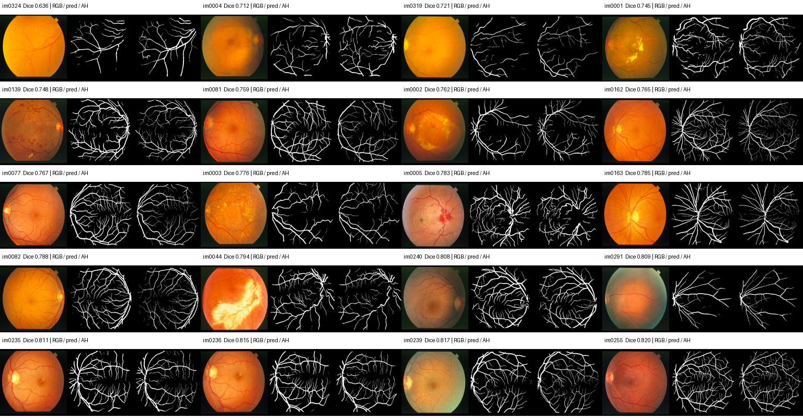

# STARE FP32 部署基线

使用冻结的 DRIVE 预训练权重，在 STARE 全部 20 张图上评估；人工参考为 AH。

**固定协议：** RGB 直接缩放至 512×512、除以 255；标注最近邻缩放；整幅画布计算；无 FOV 排除、无 TTA。阈值固定 0.4196，没有在这 20 张图上搜索阈值。

- 逐图平均 Dice：0.771139（总体标准差 0.043513）
- 逐图平均 IoU：0.629473
- 逐图平均 Precision / Recall：0.712214 / 0.860384
- 合并全部像素后的 Dice / IoU：0.776797 / 0.635051
- 最低 / 最高 Dice：im0324 (0.6359) / im0255 (0.8204)

这是当前部署输入协议的浮点参考，不是论文复现。后续若用这些图校准量化或选择模型，应将其视为开发集，另留独立测试集；不应再称为未见测试性能。

每张图输出浮点 logit、概率、掩膜、对比图和报告。summary.json 保存逐图指标、混淆计数、输入与权重哈希。CPU 时间仅为每图一次预热后的前向记录，不包含图像处理，不是稳定测速或 FPGA 时间。

| 图像 | Dice | IoU | Precision | Recall |
|---|---:|---:|---:|---:|
| [im0001](im0001/comparison.png) | 0.7447 | 0.5933 | 0.6990 | 0.7968 |
| [im0002](im0002/comparison.png) | 0.7620 | 0.6155 | 0.7431 | 0.7819 |
| [im0003](im0003/comparison.png) | 0.7764 | 0.6345 | 0.7130 | 0.8522 |
| [im0004](im0004/comparison.png) | 0.7119 | 0.5527 | 0.8213 | 0.6283 |
| [im0005](im0005/comparison.png) | 0.7834 | 0.6440 | 0.7101 | 0.8736 |
| [im0044](im0044/comparison.png) | 0.7938 | 0.6582 | 0.6924 | 0.9300 |
| [im0077](im0077/comparison.png) | 0.7670 | 0.6221 | 0.6318 | 0.9759 |
| [im0081](im0081/comparison.png) | 0.7591 | 0.6117 | 0.6247 | 0.9670 |
| [im0082](im0082/comparison.png) | 0.7884 | 0.6508 | 0.6739 | 0.9498 |
| [im0139](im0139/comparison.png) | 0.7477 | 0.5970 | 0.6316 | 0.9159 |
| [im0162](im0162/comparison.png) | 0.7654 | 0.6200 | 0.6464 | 0.9381 |
| [im0163](im0163/comparison.png) | 0.7846 | 0.6455 | 0.6605 | 0.9660 |
| [im0235](im0235/comparison.png) | 0.8113 | 0.6826 | 0.7166 | 0.9349 |
| [im0236](im0236/comparison.png) | 0.8154 | 0.6884 | 0.7307 | 0.9223 |
| [im0239](im0239/comparison.png) | 0.8172 | 0.6909 | 0.7458 | 0.9038 |
| [im0240](im0240/comparison.png) | 0.8081 | 0.6780 | 0.7503 | 0.8756 |
| [im0255](im0255/comparison.png) | 0.8204 | 0.6955 | 0.7374 | 0.9244 |
| [im0291](im0291/comparison.png) | 0.8085 | 0.6786 | 0.7836 | 0.8351 |
| [im0319](im0319/comparison.png) | 0.7213 | 0.5640 | 0.7374 | 0.7058 |
| [im0324](im0324/comparison.png) | 0.6359 | 0.4662 | 0.7943 | 0.5302 |
