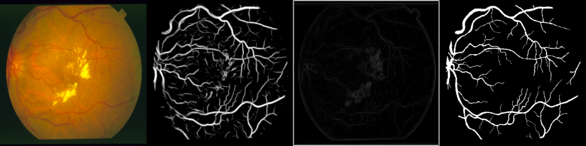

# 成果展示：FPGA 医学影像边缘工作站

> PLD 竞赛选题 1（医学影像）· 平台 FZ3B（Zynq UltraScale+ XAZU3EG）· 2026-10-14 快照
> 仅用于工程教学与算法演示，只做"辅助测量与复核"，**不作临床诊断依据**。工程总入口见 [README.md](README.md)。

## 一句话

一块 FZ3B 板子上：**PL 是一台固定结构的 U-Net 张量引擎，换"程序"只换权重**。
同一个比特流跑眼底血管、皮肤病灶、心超左心室、CT 脾脏等 17 个程序（学出来的模型和编译出来的经典算子都有）。
一个 CT 病例或一段心超视频上传一次，就在板上做完全部计算；PC 只负责选文件和显示。

```
            ┌──────────────────────── FZ3B ─────────────────────────┐
 PC 上位机   │  PS（ARM A53 ×4）                PL（FPGA）            │
 选文件/显示 │  通信、调度、整病例任务、        预处理（行缓冲）         │
 ◄─以太网──► │  临床测量、程序包安装            U-Net 张量引擎（conv + eltwise）│
            │                                  后处理 pp_layer（放大/连通块/填洞）│
            └────────────────────────────────────────────────────────┘
```

## 核心数字

| 方面 | 结果 |
| --- | --- |
| 结果可信 | 所有整数通路**逐位验证**：板上输出 = HLS 位级参考 = 离线评测（眼底 512 整帧 0/262 144 差异；17 个程序每次升级全部回归） |
| 一个比特流，多种任务 | 17 个内置程序共用同一比特流，运行时按帧切换；新模型可打成程序包装上板，**服务端和比特流都不用改**，安装时板上自检逐位一致 |
| 速度 | 眼底 512 整网约 472 ms，只占 1 个 ARM 核；同板 4 核 NEON 优化版约 565 ms。128 档约 32 ms；实时通路约 30 帧/秒 |
| PL 优化（本项目自己做的） | 真双口张量 BRAM + 卷积 V12：512 整网 566 → 473 ms；预处理整帧缓冲改行缓冲：BRAM 199 → 136.5 块 |
| 整病例上板 | CT 整卷（NIfTI 原文件）、EchoNet 整段心超、双平面 Simpson、配准搜索，都在板上一次做完 |

## 1. 心超（旗舰）：CAMUS + EchoNet-Dynamic

**CAMUS**（官方 50 人测试集，只评估一次）：

| 功能 | 测试集结果 |
| --- | --- |
| F1 左心室分割 | Dice **0.918**（验证集 0.920，没有过拟合验证集的迹象） |
| F2 点击纠错（上位机点击、FPGA 更新掩膜） | 点 1 次 Dice 0.939，3 次 0.952，5 次 0.959 |
| F3 序列传播 | ES 帧 Dice 0.922（逐帧 F1 为 0.904），帧间跳变减半（0.044 → 0.024） |
| F4 双平面 Simpson 射血分数 | 界面默认流程：EF 平均绝对误差 **5.0** 个百分点，r = 0.84；每个视图点 1–2 次后为 4.0，r = 0.91。官方 EF 方法的移植在 500/500 位病人上复现参考值；板上 Simpson 与 PC 在 450 例上逐位一致，板上快 7.7 倍 |
| F5 连续帧配准 | 已知平移恢复：三步搜索 100/100、全搜索 30/30 |


CAMUS 引用：S. Leclerc et al., "Deep Learning for Segmentation using an Open Large-Scale Dataset in 2D Echocardiography", IEEE TMI 38(9):2198–2210, 2019.

**EchoNet-Dynamic**（实时心超工作站，整段视频在板上分析）：
- 逐拍 EF：VAL 平均绝对误差 5.4（实时隔帧分析 5.35）。TEST 还没动。
- 临床测量：给出 LVEF 分档（≤40 / 41–49 / ≥50，2021 ESC），离分界太近时标"建议复核"；RR 间期由容积曲线推出，节律不齐时提示。
- 这些临床测量在板上和 PC 上算出的结果完全相同（VAL 40 段核对）。
- 实时节拍模式下，最后一帧只比视频本身滞后约 35 ms。
- 按 EchoNet 的数据协议，视频帧不能转发，所以这里不放截图。

## 2. CT 脾脏：整卷上板

| 项 | 结果 |
| --- | --- |
| 分割（MSD Task09，测试集 7 例，只评估一次） | 两阶段（粗分割 + ROI 精分割）三维 Dice **0.968**，最差一例 0.960，HD95 2.0 mm |
| 整病例在板上 | 上传 `.nii.gz` 原文件，板上解压、窗宽窗位、两阶段 PL 推理、PL 双线性放大、三维最大连通块、体积和脾脏测量全部完成；11 卷与 PC 流程逐位相同 |
| 临床测量 | 体积（VAL 误差带 −1.6% ± 3.2%）、头尾长度、宽、厚、脾指数；按体重给出脾大阈值（3.01 × kg + 127 mL，Perez 2023）；随访时判断是否达到 SVR35 |


## 3. 眼底、皮肤与"权重即程序"

| 程序 | 结果 |
| --- | --- |
| 眼底血管（STARE，512） | AUC（视野内）0.978；20 张图全部参与过模型选择，只算开发验证 |
| 皮肤病灶（ISIC 2016 官方测试集 379 张） | Jaccard **0.818** / Dice 0.891；板上 379/379 张 logit 与离线逐值一致 |
| 算子编译器 | 把经典算子（中值、均值、帧差、形态学、4 方向线检测等）写成表达式，**自动编译成同一张 U-Net 的权重**；HLS 模拟器和板上都 0 差异；可以和学习模型在板上串联 |




## 4. 怎么保证"板上算的就是评测的"

- **逐位**：整数通路（预处理、U-Net、PL 后处理、配准代价、叠加图）的输出都和独立的位级参考逐值比对。
- **按容差**：浮点测量（容积、EF、三维渲染）按容差验收，写明最大偏差。
- **测试集只用一次**：评测前先写锁文件。模型、阈值、后处理都只在验证集上定。
- **每次换固件或服务端**：都跑全套上板验收（BoardCheck 31 项、严格逐位比对、PL 后处理 182 个向量、17 个程序回归、1000 帧稳定性），失败自动回滚。证据在 `board_acceptance_*/`。
- **如实记录**：没变快的地方照写。例如整病例上板时，PL 本身就是瓶颈，CT 整卷只快约 10%，心超反而慢约 4%；它的价值在于 PC 不用参与计算。

## 5. 进行中（P1，2026-10-14 起，尚未上板）

| 项 | 本机已验证的结果 |
| --- | --- |
| PL 配准引擎 + 图形叠加（新 HLS 核 `vis_layer`） | 平移、¼ 像素整数双线性插值、代价计算和搜索全部在 PL 里做；叠加图（alpha / 轮廓 / 热力图）由 PL 合成。614 个测试向量逐位通过，已知平移 100/100，¼ 像素 10/10；与现有 F5 结果和 PC 叠加图逐位相同。资源压缩方案待定 |
| 三维表面重建搬到板上（C） | 与 PC 版在 15 个体、90 张渲染图上逐像素相同；在本机上比 Python 快 5–7 倍 |
| CAMUS 新程序：左心房、左室心外膜 | 验证集 Dice 分别为 0.882、0.937；接下来做左房容积指数、左室质量、壁厚（阈值核对 ASE 原文） |
| 板子独立运行（DP 显示器 + 鼠标）、可观测面板 | 计划中 |

## 复现与细节

| 想看 | 位置 |
| --- | --- |
| 工程总入口、目录、环境、规则 | [README.md](README.md) |
| 当前计划 | [待办优先级_2026-10-14.md](待办优先级_2026-10-14.md) |
| 板端全部历史和验收记录 | `tcp_image/tcp_image_rx/progress_and_handoff.md` |
| 各条线的训练、量化、评测 | `echo/`、`echonet/`、`ct/`、`skin/`、`opcomp/` 下的 README |
| 临床测量的定义和出处 | `tcp_image/tcp_image_rx/docs/clinical_measurements_2026-10-13.md` |
